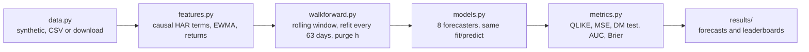

# Volatility Regime ML

[](https://github.com/Avinash186200/volatility-regime-ml/actions/workflows/ci.yml)  [](LICENSE)

Several genuinely different volatility forecasters, one shared leak-free evaluation, and an honest answer to two questions: why do they disagree, and does combining them help?

This is a research project I designed and mentored. I wrote the brief and the starter code, and set the ground rules: same data, same splits and same loss for every model, nothing tuned on the test set, and "it doesn't beat HAR-RV" counts as a real result. This repo is my own working implementation of that brief. It runs on a **synthetic regime-switching market** by default, and can download free public daily data at runtime. No data is committed.

## What problem this solves

Risk sizing, option pricing and vol-targeted portfolios all need a forecast of how much prices will move. There are many ways to make that forecast, and it is easy to compare them unfairly, for example by tuning on the test period or letting training labels overlap the test window. This repo puts several forecasters through one leak-free test, so the comparison means something, and then asks why they disagree and whether combining them helps.

## What you will learn

- What realised variance is, and why it is a better target than a squared daily return.
- How EWMA, GARCH(1,1) and HAR-RV forecast volatility, and why they see different information.
- How to set up a rolling walk-forward test with a purge, so overlapping multi-day targets do not leak.
- How to score variance forecasts with QLIKE and MSE, and test a difference with Diebold-Mariano.
- How to use an ablation to find out where a model's gain really comes from.
- How to build an ensemble whose weights use past data only.
- How to write tests that catch look-ahead: perturb the future and check nothing changes, cut the data and check nothing changes.

## Key concepts

- **Volatility / variance:** how much returns spread out. Variance is volatility squared. Here it is annualised (x252).
- **Realised variance (RV):** the sum of squared intraday returns for one day. A much less noisy measure of that day's variance than one squared daily return.
- **Garman-Klass estimator:** a variance estimate from one day's open, high, low and close. Used when only daily data is available.
- **EWMA:** an exponentially weighted moving average of past RV. Recent days count more.
- **GARCH(1,1):** a model where today's variance depends on yesterday's squared return and yesterday's variance. Fitted by maximum likelihood.
- **HAR-RV:** a linear regression of future RV on the last day's, week's and month's average RV. Simple, and hard to beat.
- **Ablation:** remove one ingredient from a model and see if the result changes. It shows which part does the work.
- **Look-ahead bias:** a forecast that uses data that would not have been known at the time. It makes results look better than they can be.
- **Walk-forward (rolling origin):** train on a past window, test on the next block, move forward, repeat. Every test block is truly out of sample.
- **Purge:** drop training rows whose target window reaches into the test block. Needed when the target is an h-day average.
- **QLIKE:** a loss for variance forecasts, `y/f - log(y/f) - 1`. It punishes under-forecasting more and is not dominated by a few spikes.
- **Diebold-Mariano (DM) test:** checks whether one model's average loss is really lower than another's, allowing for autocorrelated losses.
- **AUC and Brier score:** AUC measures how well a classifier ranks high-regime days above low ones (0.5 is chance, 1.0 is perfect). Brier is the mean squared error of the predicted probability.
- **Ensemble:** an average of several models' forecasts.

## At a glance

| | |
|---|---|
| **Input** | Daily `close`, `ret` (log return) and `rv` (realised variance): synthetic, a user CSV, or free OHLC data downloaded at runtime |
| **Method** | EWMA, GARCH(1,1), HAR-RV, a log-HAR ablation, a regime classifier feeding a regime-conditional HAR, and two ensembles, all through one rolling-origin walk-forward |
| **Output** | Out-of-sample variance forecasts at 1, 5 and 22 days, QLIKE and MSE against HAR with Diebold-Mariano tests, regime classifier AUC/Brier, and a vol-targeting sanity check |
| **Leakage controls** | Features use data up to the forecast day only, purge of `h` rows before each test block, thresholds and ensemble weights from past data only, a truncation test and a pure-noise test in CI |
| **Status** | Research complete on synthetic data. No real-data claims |

## How it works



In plain text: data -> causal features -> rolling walk-forward (refit every 63 days, purge h) -> forecasts -> QLIKE / MSE / DM.

1. **Data.** The synthetic market has a calm (12% vol) and a stress (35% vol) regime, a leverage effect and rare jumps. Each day is built from 78 intraday returns, so `rv` is a real realised variance. For public data, `rv` is the Garman-Klass range estimator from daily OHLC.
2. **Features at the close of day t**, using days up to t only: daily, weekly and monthly realised variance (the HAR components), an EWMA, the day's negative return, and their logs.
3. **Target**: the average realised variance over days t+1 to t+h.
4. **Forecasters**, all with the same `fit` / `predict` interface:

   | Model | What it captures |
   |---|---|
   | `hist_mean` | Nothing. The training-window average, as a floor |
   | `ewma` | Recent realised variance, RiskMetrics lambda 0.94 (fixed, not tuned) |
   | `garch` | GARCH(1,1) fitted by maximum likelihood on daily returns only |
   | `har` | HAR-RV (Corsi, 2009): OLS on daily, weekly and monthly RV. The benchmark |
   | `log_har` | HAR on log variance plus a leverage term. An ablation |
   | `regime_har` | `log_har` plus the regime classifier's P(high regime) and its interaction with daily RV |
   | `ens_equal` | Equal-weight average of `ewma`, `garch`, `har`, `regime_har` |
   | `ens_invloss` | Inverse-QLIKE weights from **earlier folds only** |

5. **Walk-forward**: a 1,000-day rolling training window, refit every 63 days. Training rows whose target window reaches into the test block are dropped.

## Results on synthetic data

Every number in this section comes from the synthetic market generator, not from a real market.

`python scripts/run_forecasts.py` (seed 7, 3,000 days, 32 folds, about 1,960 out-of-sample forecasts per horizon). QLIKE relative to HAR, so below 1.00 is better than HAR:

| Model | h = 1 | h = 5 | h = 22 |
|---|---|---|---|
| Historical mean | 8.75 | 8.35 | 4.06 |
| EWMA | 1.77 | 1.63 | 1.07 |
| GARCH(1,1) | 2.05 | 1.92 | 1.27 |
| **HAR-RV** (QLIKE) | **1.00** (0.061) | **1.00** (0.061) | **1.00** (0.123) |
| Log-HAR + leverage | 0.80 | 0.70 | 0.71 |
| Regime HAR | 0.83 | 0.75 | 0.86 |
| Equal-weight ensemble | 1.17 | 1.09 | 0.90 |
| Inverse-loss ensemble | 1.04 | 0.97 | 0.88 |

The full output, with MSE ratios and Diebold-Mariano statistics, is printed by the script and written to `results/` (git-ignored) as `forecasts_h<h>.csv` and `leaderboard_h<h>.csv`.

What I take from this:

- **Why GARCH loses**: it only sees daily close-to-close returns, while HAR and EWMA see intraday realised variance. One squared daily return is a very noisy measure of that day's variance, so GARCH is fitting noise. This is the standard finding (Andersen, Bollerslev, Diebold and Labys, 2003), and the gap is about information, not about the model.
- **The regime model's gain is not about regimes**. It beats HAR, but the log-HAR ablation, which has the same log transform and leverage term and no regime probability, does at least as well at every horizon. Where the classifier is useful is classification: out of sample it separates the high regime with an AUC of 0.98 at h = 1, against 0.92 for simply ranking the current EWMA level. The same probability adds nothing to a variance forecast that already has the log RV terms.
- **Combining**: the equal-weight average is worse than HAR at short horizons because two of its four members are clearly weaker. Inverse-loss weights from past folds recover most of that, and both ensembles beat HAR at 22 days, but neither beats the best single model. Here, combining did not earn its keep.
- **Economic check** (h = 1, scaling returns to a 10% vol target): the spread of the 63-day realised vol around the target is 0.51 with the historical mean, 0.12 with HAR and 0.11 with the regime model. Better variance forecasts do give steadier risk, but this ignores costs, leverage limits and the volatility risk premium, so it is a sanity check, not a strategy.

These numbers come from a generator I wrote, with regimes and leverage planted in it, so they show what the methods **can** recover, not what they will do on a market. With the regimes, leverage and jumps switched off, no model beats the historical mean and the classifier's AUC is about 0.5. That check is a test in CI.

> **About real data.** `--ticker` downloads free daily OHLC at runtime and runs exactly the same pipeline. I don't publish real-data numbers here. With daily data only, `rv` is a range estimator and misses the overnight gap, so the GARCH and HAR comparison changes, and nothing has been through a final hold-out. The published literature finds HAR-type models hard to beat on real data, and that matches my expectation.

## Leakage and bias audit

The original starter code and exploration notebook had these issues. All are fixed here, and the details are in [docs/methodology.md](docs/methodology.md).

| Issue | Effect | Fix |
|---|---|---|
| One date split, with the last training row's target being the first test day's variance (h days of overlap at horizon h) | Training labels from inside the test period | Purge of `h` rows before every test block; tested for h = 1, 5 and 22 |
| The naive baseline was scored on target days shifted by one day from the HAR target | The "HAR beats naive by about 22%" comparison was not like-for-like | One target and one index shared by every model |
| A single train/test split, with GARCH and HAR parameters estimated once | The conclusion rested on one test window | Rolling-origin refits every 63 days, 32 folds |
| RMSE on annualised squared daily returns | A noisy proxy, with the score dominated by a few spikes | QLIKE and MSE (robust to proxy noise, Patton 2011), a Diebold-Mariano test, and a better `rv` (intraday, or Garman-Klass) |
| HAR in levels can forecast a negative variance | Undefined QLIKE, and nonsense forecasts in calm periods | Floored at half the smallest training target |
| Ensemble weights, the regime threshold and the EWMA lambda could be picked on the test period | Selection bias | Weights from earlier folds only, the threshold from the training quantile, and lambda fixed at 0.94 |
| The regime probability fed into the second stage was in-sample | The second stage would trust an over-fitted probability | Cross-fitted on training blocks with an `h`-row purge |
| Results reported only at one horizon | Picking the horizon that looks best | Every run reports 1, 5 and 22 days |

## Repo layout

```
src/volregime/   data.py (synthetic market, CSV, download) · features.py · models.py · walkforward.py · metrics.py
scripts/         run_forecasts.py (the CLI that prints the tables above)
tests/           test_volregime.py: causality per model, truncation, purge, GARCH recovery, noise test
docs/            README.md (index) · methodology.md (method and bias audit)
original/        the original brief, starter code and notebook (read-only)
results/         created by the script, git-ignored
.github/         CI workflow
```

## Quick start

```bash
pip install -r requirements.txt
pytest -q
python scripts/run_forecasts.py                          # synthetic, about 20 s
python scripts/run_forecasts.py --horizons 1 5 --expanding
pip install yfinance && python scripts/run_forecasts.py --ticker SPY   # public data, not committed
python scripts/run_forecasts.py --csv your_daily_ohlc.csv
```

`your_daily_ohlc.csv` is your own file and is not shipped. It needs a `date` column plus either `open, high, low, close` or `close, rv`. The `--ticker` run needs network access and prints real-data numbers to your screen only; I do not publish them here (see the note above). `python scripts/run_forecasts.py --help` lists every option.

## Original research code

[`original/`](original/README.md) holds the original project code: the brief and starter code I wrote, plus the
first exploration notebook from the project. It is kept so you can read the first version alongside the
maintained one; some of it contains the issues in the audit table above, and comparing the two shows each fix.

## License

MIT

See [CONTRIBUTING.md](CONTRIBUTING.md) and the [CHANGELOG](CHANGELOG.md).
